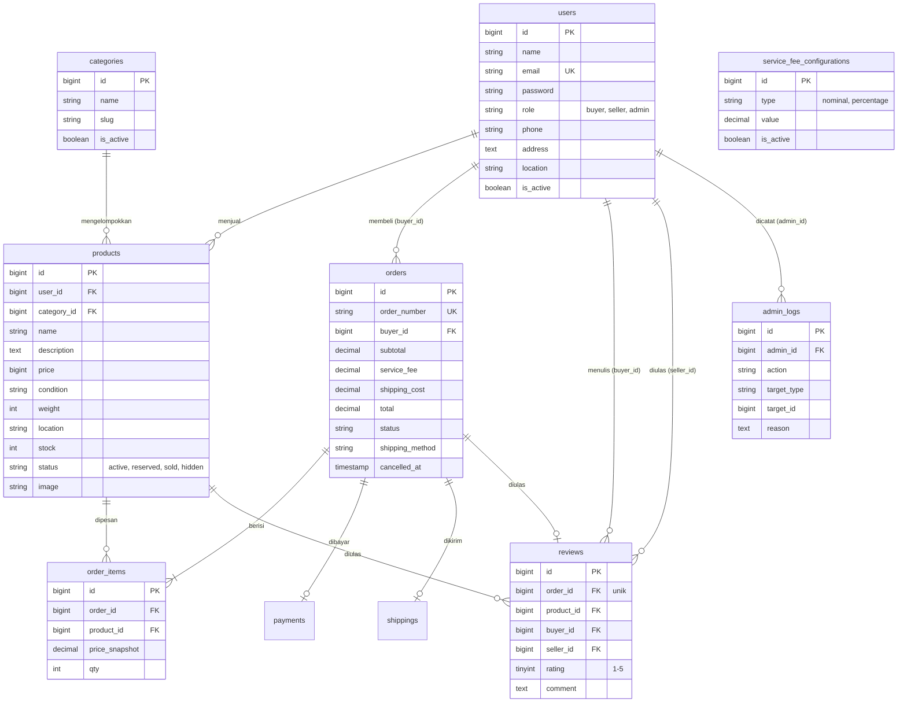

# Dokumentasi Database SECONDTECH

Database: MySQL (`secondtech`). Struktur dibuat lewat migration di `database/migrations`.

## Diagram ERD

Tabel `payments` dan `shippings` milik fitur pembayaran dan pengiriman (relasi satu-ke-satu dengan `orders`); kolom detailnya mengikuti migration masing-masing.

## Penjelasan Tabel

| Tabel | Fungsi |
|---|---|
| users | Akun pengguna dengan role buyer, seller, atau admin; `is_active` untuk menonaktifkan akun |
| categories | Kategori produk elektronik; kategori nonaktif tidak bisa dipilih |
| products | Produk yang dijual; `status` mengatur tampil di katalog |
| orders | Pesanan; menyimpan subtotal, biaya layanan (snapshot), ongkir, total, dan status |
| order_items | Produk dalam pesanan, dengan harga saat checkout (`price_snapshot`) |
| payments | Pembayaran per pesanan, diverifikasi admin |
| shippings | Pengiriman per pesanan: ekspedisi dengan resi, atau kesepakatan COD |
| reviews | Rating 1-5 dan komentar; `order_id` unik sehingga satu pesanan hanya satu ulasan |
| service_fee_configurations | Riwayat pengaturan biaya layanan; yang `is_active` dipakai checkout |
| admin_logs | Catatan aktivitas admin (moderasi produk, ubah biaya layanan) |

## Alur Status Pesanan

- Ekspedisi: `pending_payment` → `paid` → `processing` → `shipped` → `received` → `completed`
- COD: `cod_requested` → `cod_agreed` → `completed`
- Pembatalan: `cancelled` (dari `pending_payment` atau `cod_requested`)